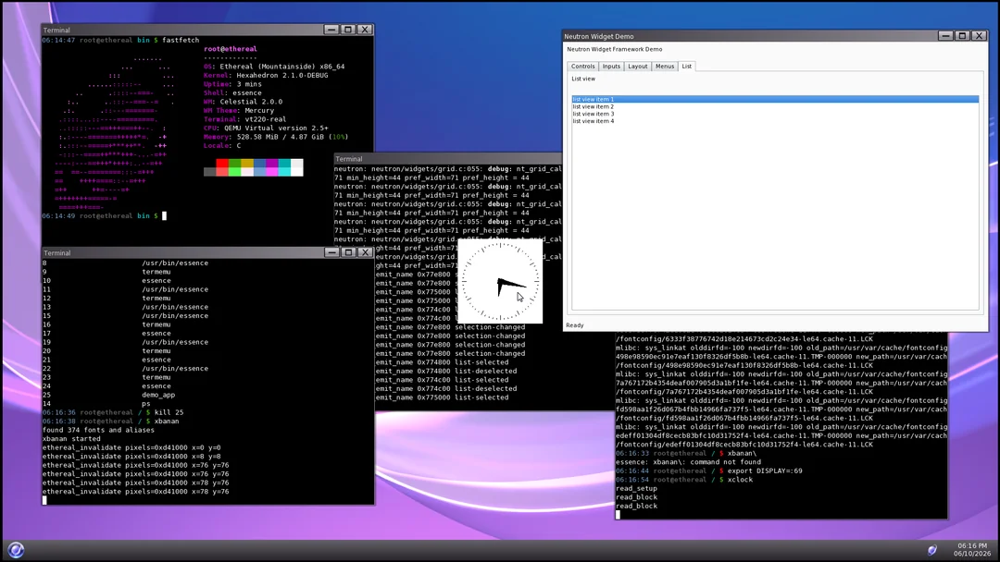

# Ethereal

A custom all-in-one hobby operating system.

## What is Ethereal?

Ethereal is a hobby UNIX-like operating system designed from the ground-up.

It is **not** Linux-based, nor does it share any code with Linux at all. Rather, it uses a custom OS kernel.

## Downloads

The latest and greatest is available in GitHub actions, or the nightly release build.

## Screenshots

\
*Ethereal*

\
*Modern, 1080p desktop environment*

\
*Ethereal older main desktop environment with DOOM*

\
*Ethereal on Libera chat (#ethereal)*

## Features

- Full SMP-enabled kernel
- Advanced page cache that makes disk syncing fast
- Custom window manager (Celestial) and userspace
- USB support for xHCI controllers
- AHCI/NVMe disk support (technically IDE too, albeit a very poorly written driver)
- Networking stack with E1000 and RTL8169 network card driver
- Support for the `mlibc` C library
- Full ACPI support with the ACPICA library (with backup MinACPI library that doesn't have AML parsing)

## Project structure

- `base`: Contains the base filesystem. Files in `base/initrd` go in the initial ramdisk (for non-LiveCD boots) and files in `base/sysroot` go in sysroot.
- `buildscripts`: Contains buildscripts for the build system
- `conf`: Contains misc. configuration files, such as architecture files, GRUB configs, extra boot files, etc.
- `drivers`: Drivers for Hexahedron, copied based on their configuration.
- `external`: Contains external projects, such as ACPICA. See External Components.
- `hexahedron`: The main kernel project
- `libkstructures`: Contains misc. structures, like lists/hashmaps/parsers/whatever
- `libc`: Contains mlibc
- `userspace`: Contains the userspace libraries and programs in Ethereal

## AI policy

See [AI_POLICY.md](AI_POLICY.md).

## Code notice

Ethereal's codebase is the result of over 2 years of effort.

In some areas, the code is extremely concise, well-written, and optimized.\
In other areas, it isn't - I learned as I made this project.

Take caution if using Ethereal as a source to learn how to make your own OS.

## Building

### ACPICA notice (READ THIS BEFORE BUILDING)

If you use ACPICA, you must download the tarfile from [here](https://downloadmirror.intel.com/834974/acpica-unix-20240927.tar.gz) and extract it to `external/acpica/acpica-src`

As of now the benefits of ACPICA is the ability to shutdown the system and hibernate, with support for the PCI IRQ routing table coming later (+ batteries).

To enable ACPI support in the system, use manual cmake configuration

### Building

To build Ethereal, you will need an Ethereal toolchain for your target architecture.\
The Ethereal toolchain can be found at [the repository](https://github.com/sasdallas/Ethereal-Toolchain)

Other packages required: `grub-common`, `xorriso`, `qemu-system`, `meson`, `ninja`, `cmake`

Running `make all` will build an ISO in `build-output/ethereal.iso`

You can run `make headers` to install the headers if attempting to build the sysroot.

**Alternative:** You can configure CMake to build specific targets if you need:

```sh
cmake -S . -B build-output --toolchain="ethereal-cmake.txt" -DENABLE_U80211=OFF -DENABLE_ACPICA=OFF
cmake --build build-output --target iso
```

Currently, Ethereal's lack of filesystem drivers means that LiveCD boots are usually the best option.\
The initial ramdisk in a LiveCD is the sysroot, and if the OS detects the boot it will copy the initial ramdisk into RAM.

## Kernel arguments

A lot of times, Ethereal fails to load. This is expected. Please start a GitHub issue.

You can solve some problems by using 'e' to open a GRUB configuration and adding some kernel arguments to the end of the `multiboot entry`.\
Here is a small list:

- `--debug=`: Options are `console` and `none`. If `console`, will redirect kernel debug output to the screen. Useful for debugging, but will cause issues if loaded to a GUI.
- `--noload=`: Comma-separated list of driver (.sys) files to not load. Problematic drivers: usb_xhci.sys, ahci.sys, ps2.sys (if you don't support PS/2),
- `--no-acpica`: Disable the ACPICA library and fallback to MinACPI implementation. Only useful in extreme cases.
- `--no-acpi`: Disable all ACPI implementations. Disables SMP as well.
- `--disable-smp`: Enable ACPI, but disable SMP

## External libraries

Multiple external libraries have been used in the creation of Ethereal.\
I thank everyone who created these libraries for their amazing work.

Note that this list includes only required libraries for OS build.

- freetype (GPL license): [available here](https://sourceforge.net/projects/freetype/)
- mlibc (MIT license): [available here](https://github.com/sasdallas/mlibc)
- tinf (zlib license): [available here](https://github.com/jibsen/tinf/)
- json-parser (BSD 2-clause license): [available here](https://github.com/json-parser/json-parser)
- flanterm (BSD 2-clause license): [available here](https://github.com/Mintsuki/Flanterm)
- tiny-regex-c (public domain): [available here](https://github.com/kokke/tiny-regex-c)
- stb_image (public domain)

Certain external components are by the same developer (that's me), however may follow a different license:

- Essence (BSD 3-clause license): [available here](https://github.com/sasdallas/Essence)
- Neutron (GPLv3 license): [available here](https://github.com/sasdallas/Neutron)

All libraries using GPLv3 licensing are compiled externally without direct code integration.

## Credits

A lot of Ethereal's userspace design was inspired by [ToaruOS by klange](https://github.com/klange/ToaruOS)

The "grab" cursor from ToaruOS is used in Celestial (art asset is located at base/sysroot/usr/share/cursors/grab.bmp).

Ethereal's virtual memory manager design and other parts was inspired by [Astral by @mathewnd](https://github.com/mathewnd/Astral)

Some code from Astral was also used, credited where appropriate. A license file is included in `external/`.

The Ethereal logo, Mercury theme, as well as all art assets not specified were designed by the artist [ArtsySquid](https://artsycomms.carrd.co)

## Licensing

Hexahedron and all other non-external components of Ethereal fall under the terms of the BSD 3-clause license (available in LICENSE).\
All files, unless specified in the copyright header, fall under this license. Any file without a copyright header is NOT protected by BSD 3-clause.

**LICENSING ISSUES:** If a file is found without proper commenting, immediately contact me (preferably through a public channel such as GitHub issues for transparency) directly to resolve it.

Ethereal's goal has never been to take code, however if it does happen please contact me!
